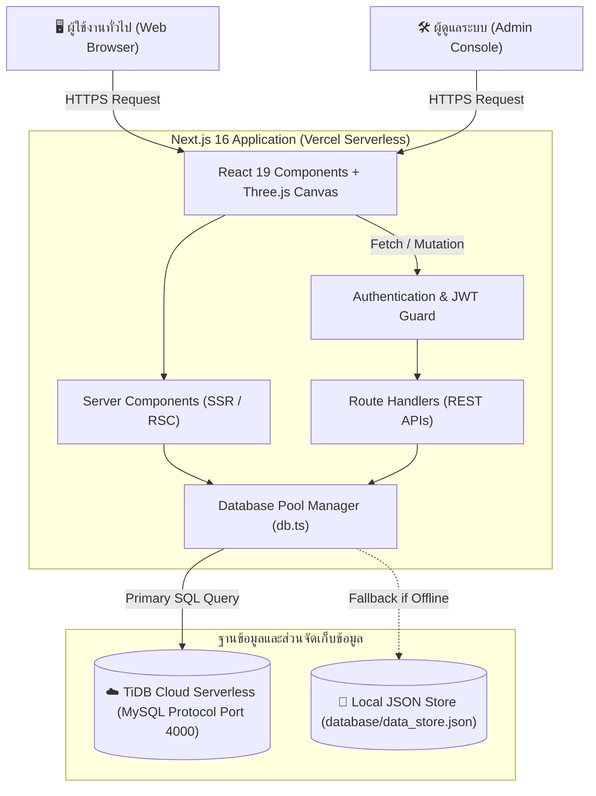
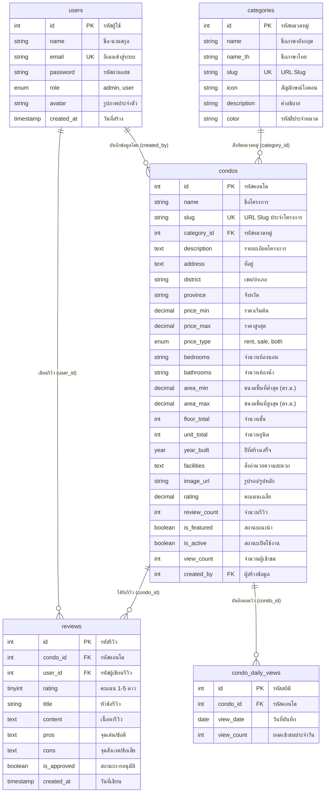

# 📑 รายงานโครงงาน: ระบบแนะนำและรีวิวคอนโดมิเนียม (CondoGuide)
**CondoGuide: Modern Architectural Condo Recommendation & Review Platform**

---

## สารบัญ (Table of Contents)
1. [บทนำและภาพรวมของโครงงาน (Project Overview)](#1-บทนำและภาพรวมของโครงงาน-project-overview)
2. [เทคโนโลยีและเครื่องมือที่ใช้พัฒนา (Technology Stack)](#2-เทคโนโลยีและเครื่องมือที่ใช้พัฒนา-technology-stack)
3. [สถาปัตยกรรมระบบ (System Architecture)](#3-สถาปัตยกรรมระบบ-system-architecture)
4. [การออกแบบฐานข้อมูลและข้อมูลในตาราง (Database Design & Table Records)](#4-การออกแบบฐานข้อมูล-database-design--data-dictionary)
5. [ฟังก์ชันการทำงานของระบบ (Functional Specifications)](#5-ฟังก์ชันการทำงานของระบบ-functional-specifications)
6. [การเชื่อมต่อ API (RESTful API Endpoints)](#6-การเชื่อมต่อ-api-restful-api-endpoints)
7. [การรักษาความปลอดภัยของระบบ (Security & Authentication)](#7-การรักษาความปลอดภัยของระบบ-security--authentication)
8. [จุดเด่นและนวัตกรรมของโครงงาน (Key Highlights & Innovations)](#8-จุดเด่นและนวัตกรรมของโครงงาน-key-highlights--innovations)
9. [บัญชีทดสอบและคู่มือการรันระบบ (Testing & Deployment Guide)](#9-บัญชีทดสอบและคู่มือการรันระบบ-testing--deployment-guide)
10. [สรุปผลการดำเนินงานและแนวทางพัฒนาต่อยอด (Conclusion & Future Work)](#10-สรุปผลการดำเนินงานและแนวทางพัฒนาต่อยอด-conclusion--future-work)

---

## 1. บทนำและภาพรวมของโครงงาน (Project Overview)

### 1.1 ที่มาและความสำคัญ
ในปัจจุบันการค้นหาและตัดสินใจเลือกที่อยู่อาศัยประเภทคอนโดมิเนียม โดยเฉพาะในเขตเมืองใหญ่และพื้นที่แนวเส้นทางรถไฟฟ้า ผู้บริโภคมักประสบปัญหาข้อมูลกระจัดกระจาย ไม่ครบถ้วน หรือขาดความน่าเชื่อถือ ข้อมูลจากผู้พัฒนาอสังหาริมทรัพย์มักเน้นการโฆษณาเพียงด้านเดียว ขาดเสียงสะท้อนจากผู้พักอาศัยจริง 

โครงงาน **CondoGuide** จึงได้รับการพัฒนาขึ้นเพื่อเป็นแพลตฟอร์มสารสนเทศอสังหาริมทรัพย์ยุคใหม่ (Next-Generation PropTech Web Application) ที่รวบรวมข้อมูลโครงการอย่างเป็นระบบ ผสานระบบรีวิวและให้คะแนนตามจริง พร้อมนำเทคโนโลยีจำลองภาพ 3 มิติเชิงสถาปัตยกรรม (3D Architectural Visualization) มาใช้บนเว็บเบราว์เซอร์ เพื่อยกระดับประสบการณ์ของผู้ใช้งานในการสำรวจและเปรียบเทียบข้อมูลคอนโดมิเนียม

### 1.2 วัตถุประสงค์ของโครงงาน (Objectives)
1. พัฒนาระบบค้นหา คัดกรอง และเปรียบเทียบข้อมูลโครงการคอนโดมิเนียมที่มีประสิทธิภาพและตอบสนองได้รวดเร็ว
2. พัฒนาระบบรีวิวและให้คะแนนความพึงพอใจ เพื่อเป็นแหล่งข้อมูลสะท้อนคุณภาพจริงจากผู้พักอาศัย
3. พัฒนาระบบบริหารจัดการข้อมูลหลังบ้าน (Admin Management System) และกระดานสรุปสถิติเชิงลึก (Business Intelligence & Analytics Dashboard)
4. ประยุกต์ใช้เทคโนโลยี Web-based 3D Graphics (Three.js & WebGL) จำลองทัศนียภาพเมืองและสถาปัตยกรรมอาคารแบบ Interactive
5. พัฒนาระบบฐานข้อมูลแบบผสมผสาน (Hybrid Database Engine) ที่รองรับทั้ง Cloud Database และ Local Persistence Fallback เพื่อป้องกันปัญหาข้อมูลสูญหาย

### 1.3 ขอบเขตของโครงงาน (Project Scope)
* **ระบบผู้ใช้งานทั่วไป (Public / Guest):**
  - ค้นหาคอนโดมิเนียมตามคำค้นหา, ย่าน/เขต, ระดับราคา, และหมวดหมู่
  - สัมผัสทัศนียภาพ 3D Hero Cityscape บนหน้าแรก
  - อ่านรายละเอียดข้อมูลโครงการ สเปกห้อง สิ่งอำนวยความสะดวก และอ่านรีวิว
* **ระบบสมาชิก (Registered User):**
  - สมัครสมาชิกและเข้าสู่ระบบด้วยมาตรฐานความปลอดภัย
  - เขียนรีวิว ให้คะแนน (1–5 ดาว) พร้อมระบุข้อดีและข้อเสีย
  - จัดการและแก้ไขข้อมูลโปรไฟล์ส่วนตัว
* **ระบบผู้ดูแลระบบ (Administrator):**
  - ติดตามสถิติยอดการเข้าชม, การกระจายตัวของราคา และสัดส่วนหมวดหมู่ผ่านกราฟ Recharts
  - ดำเนินการ CRUD (เพิ่ม, เรียกดู, แก้ไข, ลบ) ข้อมูลคอนโดมิเนียม
  - จัดการหมวดหมู่คอนโดมิเนียม (Categories)
  - ตรวจสอบ อนุมัติ และลบรีวิวที่ไม่เหมาะสม
  - จัดการรายชื่อและกำหนดสิทธิ์ผู้ใช้งาน (User & Role Management)

---

## 2. เทคโนโลยีและเครื่องมือที่ใช้พัฒนา (Technology Stack)

| องค์ประกอบ | เทคโนโลยี / เครื่องมือ | เวอร์ชัน / รายละเอียด | ประโยชน์และเหตุผลในการเลือกใช้ |
| :--- | :--- | :--- | :--- |
| **Framework** | Next.js (App Router) | 16.4.0 | รองรับ React Server Components, Fast Page Loads และ SEO ที่มีประสิทธิภาพสูง |
| **UI Library** | React | 19.3.0 | Component-Based Architecture สำหรับจัดการ State และ UI แบบไดนามิก |
| **Programming Language** | TypeScript | 5.x | Static Typing ป้องกันข้อผิดพลาดด้าน Data Type ระหว่างการพัฒนา |
| **Styling & Theme** | Vanilla CSS + Design Tokens | Custom CSS | ควบคุมประสิทธิภาพสูงสุด ออกแบบสไตล์ Modern Architectural Dark/Light Theme พร้อม Glassmorphism |
| **3D Graphics** | Three.js & @react-three/fiber | 0.170.0 | เรนเดอร์กราฟิกจำลองเมือง 3 มิติแบบ WebGL Canvas แบบเรียลไทม์ |
| **3D Helpers** | @react-three/drei | 10.7.9 | ควบคุมกล้อง แสง และ Interaction ในฉาก 3 มิติ |
| **Data Visualization** | Recharts | 3.10.1 | เรนเดอร์กราฟแท่ง กราฟโดนัท และกราฟเส้นสถิติในหน้า Admin Dashboard |
| **Database System** | TiDB Cloud Serverless | MySQL 8.0 Compatible | ฐานข้อมูล Cloud Distributed SQL รองรับ Auto-Scaling ความเร็วสูง |
| **Database Client** | mysql2 | 3.24.5 | การเชื่อมต่อ Connection Pool พร้อมฟังก์ชัน Keep-Alive และ Auto-Reconnect |
| **Authentication** | JWT (`jose` / `jsonwebtoken`) | 6.x / 9.x | ออกและตรวจสอบ Token ยืนยันตัวตนผ่าน HTTP-Only Cookie ป้องกัน XSS |
| **Password Hashing** | bcryptjs | 3.0.3 | เข้ารหัสลับรหัสผ่านแบบทางเดียว (Salt 10 Rounds) |
| **Icon Library** | Lucide React | 1.55.0 | ไอคอน SVG คุณภาพสูง สะอาดตา และกินทรัพยากรน้อย |
| **Cloud Hosting & CI/CD** | Vercel Platform | Production Serverless | ระบบ Cloud Deployment เชื่อมต่อ Git อัตโนมัติ |

---

## 3. สถาปัตยกรรมระบบ (System Architecture)

### 3.1 ภาพรวมสถาปัตยกรรม (System Architecture Diagram)



### 3.2 การไหลของข้อมูล (Data Flow Process)
1. **การค้นหาและแสดงผล:** ผู้ใช้เรียกหน้าเว็บ Next.js Server Components ทำการ Query ข้อมูลจาก TiDB Cloud ผ่าน Connection Pool โดยตรง แล้วส่ง HTML สำเร็จรูปพร้อมข้อมูลให้เบราว์เซอร์ ช่วยให้หน้าเว็บเปิดได้ทันที
2. **การยืนยันตัวตน:** เมื่อผู้ใช้เข้าสู่ระบบ รหัสผ่านจะถูกตรวจสอบด้วย `bcrypt.compare` หากถูกต้องจะสร้าง `token` (JWT) และบันทึกลงใน `HTTP-Only Cookie`
3. **การประมวลผลคำขอแอดมิน:** ทุกคำขอไปยัง `/api/admin/*` จะถูกตรวจสอบสิทธิ์ Role = 'admin' ผ่าน Middleware ก่อนทำการเปลี่ยนแปลงข้อมูลในฐานข้อมูล

---

## 4. การออกแบบฐานข้อมูล (Database Design & Data Dictionary)

### 4.1 แผนภาพความสัมพันธ์ของข้อมูล (Entity-Relationship Diagram: ERD)



---

### 4.2 พจนานุกรมข้อมูล (Data Dictionary)

#### 1) ตาราง `users` (ตารางผู้ใช้งาน)
| ฟิลด์ (Field) | ประเภทข้อมูล (Type) | คีย์ (Key) | Null | คำอธิบาย (Description) |
| :--- | :--- | :---: | :---: | :--- |
| `id` | INT | **PK** | NO | รหัสประจำตัวผู้ใช้ (Auto Increment) |
| `name` | VARCHAR(100) | - | NO | ชื่อผู้ใช้ / ชื่อแสดงผล |
| `email` | VARCHAR(150) | **UK** | NO | อีเมลสำหรับล็อกอิน (ไม่ซ้ำกัน) |
| `password` | VARCHAR(255) | - | NO | รหัสผ่านที่เข้ารหัสลับด้วย bcrypt |
| `role` | ENUM('admin', 'user') | - | NO | สิทธิ์การใช้งาน (ค่าเริ่มต้น: 'user') |
| `avatar` | VARCHAR(255) | - | YES | ลิงก์รูปภาพโปรไฟล์ |
| `created_at` | TIMESTAMP | - | NO | วันที่และเวลาสร้างบัญชี |
| `updated_at` | TIMESTAMP | - | NO | วันที่และเวลาแก้ไขล่าสุด |

#### 2) ตาราง `categories` (ตารางหมวดหมู่)
| ฟิลด์ (Field) | ประเภทข้อมูล (Type) | คีย์ (Key) | Null | คำอธิบาย (Description) |
| :--- | :--- | :---: | :---: | :--- |
| `id` | INT | **PK** | NO | รหัสหมวดหมู่ (Auto Increment) |
| `name` | VARCHAR(100) | - | NO | ชื่อหมวดหมู่ภาษาอังกฤษ (เช่น Luxury, Studio) |
| `name_th` | VARCHAR(100) | - | YES | ชื่อหมวดหมู่ภาษาไทย (เช่น หรูหรา, สตูดิโอ) |
| `slug` | VARCHAR(100) | **UK** | NO | Identifier สำหรับเรียกดูผ่าน URL |
| `icon` | VARCHAR(50) | - | YES | อีโมจิหรือไอคอนประจำหมวดหมู่ |
| `description` | TEXT | - | YES | คำอธิบายรายละเอียดของหมวดหมู่ |
| `color` | VARCHAR(20) | - | YES | โค้ดสีประจำหมวดหมู่ (Hex Code) |
| `created_at` | TIMESTAMP | - | NO | วันที่สร้างหมวดหมู่ |

#### 3) ตาราง `condos` (ตารางข้อมูลโครงการคอนโดมิเนียม)
| ฟิลด์ (Field) | ประเภทข้อมูล (Type) | คีย์ (Key) | Null | คำอธิบาย (Description) |
| :--- | :--- | :---: | :---: | :--- |
| `id` | INT | **PK** | NO | รหัสโครงการ (Auto Increment) |
| `name` | VARCHAR(200) | - | NO | ชื่อคอนโดมิเนียม |
| `slug` | VARCHAR(200) | **UK** | NO | ชื่อย่อสำหรับ URL เช่น `lumpini-park-rama9` |
| `category_id` | INT | **FK** | NO | รหัสหมวดหมู่อ้างอิง `categories.id` |
| `description` | TEXT | - | YES | ข้อมูลรายละเอียดโครงการ |
| `address` | TEXT | - | YES | ที่อยู่ของโครงการ |
| `district` | VARCHAR(100) | - | YES | เขต/อำเภอ (เช่น วัฒนา, จตุจักร, บางนา) |
| `province` | VARCHAR(100) | - | YES | จังหวัด (ค่าเริ่มต้น: กรุงเทพมหานคร) |
| `price_min` | DECIMAL(12,2) | - | YES | ราคาเริ่มต้น (บาท) |
| `price_max` | DECIMAL(12,2) | - | YES | ราคาสูงสุด (บาท) |
| `price_type` | ENUM('rent','sale','both') | - | NO | ประเภทราคา (เช่า, ขาย, หรือทั้งสอง) |
| `bedrooms` | VARCHAR(50) | - | YES | จำนวนห้องนอน (เช่น "1", "1-3") |
| `bathrooms` | VARCHAR(50) | - | YES | จำนวนห้องน้ำ |
| `area_min` | DECIMAL(8,2) | - | YES | พื้นที่ใช้สอยต่ำสุด (ตร.ม.) |
| `area_max` | DECIMAL(8,2) | - | YES | พื้นที่ใช้สอยสูงสุด (ตร.ม.) |
| `floor_total` | INT | - | YES | จำนวนชั้นทั้งหมด |
| `unit_total` | INT | - | YES | จำนวนยูนิตรวมของโครงการ |
| `year_built` | YEAR | - | YES | ปีที่สร้างแล้วเสร็จ |
| `facilities` | TEXT | - | YES | สิ่งอำนวยความสะดวก คั่นด้วยจุลภาค |
| `image_url` | VARCHAR(500) | - | YES | ลิงก์รูปภาพหน้าปกโครงการ |
| `rating` | DECIMAL(3,2) | - | NO | คะแนนเฉลี่ย (คำนวณจากรีวิว ค่าเริ่มต้น 0.00) |
| `review_count` | INT | - | NO | จำนวนรีวิวรวม |
| `is_featured` | BOOLEAN | - | NO | สถานะแนะนำในหน้าแรก (True/False) |
| `is_active` | BOOLEAN | - | NO | สถานะการเปิดเผยข้อมูล (True/False) |
| `view_count` | INT | - | NO | จำนวนครั้งที่มีการเปิดเข้าชม |
| `created_by` | INT | **FK** | YES | ผู้สร้างข้อมูล อ้างอิง `users.id` |
| `created_at` | TIMESTAMP | - | NO | วันที่บันทึกข้อมูล |
| `updated_at` | TIMESTAMP | - | NO | วันที่แก้ไขข้อมูลล่าสุด |

#### 4) ตาราง `reviews` (ตารางความคิดเห็นและรีวิว)
| ฟิลด์ (Field) | ประเภทข้อมูล (Type) | คีย์ (Key) | Null | คำอธิบาย (Description) |
| :--- | :--- | :---: | :---: | :--- |
| `id` | INT | **PK** | NO | รหัสรีวิว (Auto Increment) |
| `condo_id` | INT | **FK** | NO | โครงการคอนโดที่ถูกรีวิว อ้างอิง `condos.id` |
| `user_id` | INT | **FK** | NO | ผู้เขียนรีวิว อ้างอิง `users.id` |
| `rating` | TINYINT | - | NO | คะแนนดาว (ค่าระหว่าง 1 - 5) |
| `title` | VARCHAR(200) | - | YES | พาดหัวรีวิว |
| `content` | TEXT | - | YES | เนื้อหารีวิวฉบับเต็ม |
| `pros` | TEXT | - | YES | จุดเด่น / ข้อดี |
| `cons` | TEXT | - | YES | จุดด้อย / ข้อเสีย |
| `is_approved` | BOOLEAN | - | NO | สถานะการอนุมัติ (ค่าเริ่มต้น: TRUE) |
| `created_at` | TIMESTAMP | - | NO | วันที่เขียนรีวิว |

#### 5) ตาราง `condo_daily_views` (ตารางสถิติยอดการเข้าชมรายวัน)
| ฟิลด์ (Field) | ประเภทข้อมูล (Type) | คีย์ (Key) | Null | คำอธิบาย (Description) |
| :--- | :--- | :---: | :---: | :--- |
| `id` | INT | **PK** | NO | รหัสสถิติ (Auto Increment) |
| `condo_id` | INT | **FK** | NO | อ้างอิงโครงการคอนโด `condos.id` |
| `view_date` | DATE | - | NO | วันที่เข้าชม (YYYY-MM-DD) |
| `view_count` | INT | - | NO | จำนวนครั้งที่เข้าชมในวันดังกล่าว |

---

### 4.3 ข้อมูลจำลองและตัวอย่างข้อมูลในตารางจริง (Table Records & Sample Data)

#### 1) ข้อมูลในตาราง `users`
| id | name | email | role | avatar | created_at |
| :---: | :--- | :--- | :---: | :---: | :--- |
| **1** | Admin | admin@condoguide.com | admin | NULL | 2024-01-01 10:00:00 |
| **2** | วรากร | warakorn@gmail.com | admin | NULL | 2026-10-12 17:19:09 |
| **3** | วาริส มินเจ | varizz@gmail.com | user | NULL | 2026-10-12 17:19:35 |

> *(หมายเหตุ: คอลัมน์ `password` ถูกเข้ารหัสด้วย bcrypt จึงแสดงผลเป็น Hash String เพื่อความปลอดภัย เช่น `$2b$10$m3ZS41r...`)*

#### 2) ข้อมูลในตาราง `categories`
| id | name | name_th | slug | icon | color | description |
| :---: | :--- | :--- | :--- | :---: | :---: | :--- |
| **1** | Luxury | หรูหรา | luxury | 👑 | `#f59e0b` | คอนโดหรูระดับพรีเมียม ดีไซน์ระดับโลก |
| **2** | Budget | ราคาประหยัด | budget | 💰 | `#10b981` | คอนโดราคาประหยัด คุ้มค่า เดินทางสะดวก |
| **3** | Studio | สตูดิโอ | studio | 🏠 | `#6366f1` | ห้อง Studio กะทัดรัด สำหรับคนทำงานรุ่นใหม่ |
| **4** | Family | ครอบครัว | family | 👨‍👩‍👧‍👦 | `#ec4899` | คอนโดห้องใหญ่ สิ่งอำนวยความสะดวกครบสำหรับครอบครัว |
| **5** | Pet Friendly | เลี้ยงสัตว์ได้ | pet-friendly | 🐾 | `#f97316` | คอนโดที่อนุญาตให้เลี้ยงสัตว์เลี้ยงได้ |
| **6** | Near BTS/MRT | ใกล้รถไฟฟ้า | near-bts-mrt | 🚆 | `#3b82f6` | คอนโดติดรถไฟฟ้า เดินทางเข้าเมืองได้ในไม่กี่นาที |

#### 3) ข้อมูลในตาราง `condos`
| id | name | slug | category_id | district | price_min | price_max | bedrooms | area_min - max | rating | views |
| :---: | :--- | :--- | :---: | :--- | :---: | :---: | :---: | :---: | :---: | :---: |
| **1** | The Ritz Residence Sukhumvit | ritz-residence-sukhumvit | 1 (Luxury) | วัฒนา | 35,000 | 150,000 | 1-3 | 35 - 120 ตร.ม. | 5.0 | 1,540 |
| **2** | Lumpini Park Rama 9 | lumpini-park-rama9 | 2 (Budget) | ห้วยขวาง | 8,500 | 25,000 | 1-2 | 24 - 68 ตร.ม. | 4.0 | 980 |
| **3** | Ideo Mobi Sukhumvit 81 | ideo-mobi-sukhumvit-81 | 6 (BTS/MRT) | พระโขนง | 12,000 | 40,000 | 1-2 | 28 - 55 ตร.ม. | 5.0 | 1,421 |
| **4** | Noble State 39 | noble-state-39 | 3 (Studio) | วัฒนา | 18,000 | 35,000 | Studio, 1 | 30 - 45 ตร.ม. | 0.0 | 650 |
| **5** | The Residences at Mandarin Oriental | mandarin-oriental-residences | 1 (Luxury) | บางรัก | 120,000 | 500,000 | 2-4 | 80 - 350 ตร.ม. | 5.0 | 2,102 |
| **6** | Whizdom Essence Sukhumvit | whizdom-essence-sukhumvit | 5 (Pet) | พระโขนง | 15,000 | 42,000 | 1-2 | 33 - 65 ตร.ม. | 0.0 | 820 |
| **7** | Life Asoke Hype | life-asoke-hype | 6 (BTS/MRT) | ราชเทวี | 14,000 | 38,000 | Studio, 1-2 | 25.5 - 64 ตร.ม. | 0.0 | 1,100 |
| **8** | The Bangkok Sathorn | the-bangkok-sathorn | 4 (Family) | สาทร | 55,000 | 200,000 | 2-3 | 106 - 152 ตร.ม. | 5.0 | 742 |

#### 4) ข้อมูลในตาราง `reviews`
| id | condo_id | user_id | rating | title | pros (ข้อดี) | cons (ข้อเสีย) | is_approved |
| :---: | :---: | :---: | :---: | :--- | :--- | :--- | :---: |
| **1** | 1 | 1 | 5 | คุ้มค่ามาก ส่วนกลางอลังการ วิวเมืองสวยสุดๆ | นิติดูแลดีมาก, ฟิตเนสชั้นนำ, เงียบสงบ | ค่าส่วนกลางค่อนข้างสูง, รถติดช่วงเย็น | TRUE |
| **2** | 2 | 1 | 4 | ทำเลดี ราคาคุ้มค่ามาก เดินทางไปทำงานสะดวก | ใกล้ห้าง, เดินทางสะดวก, ของกินเยอะ | คนค่อนข้างเยอะช่วงเช้าต้องรอลิฟต์ | TRUE |
| **3** | 3 | 1 | 5 | ใกล้ BTS มาก เดินไม่ถึง 3 นาที | ใกล้ BTS อ่อนนุช, ใกล้โลตัส, ห้องเงียบ | ที่จอดรถค่อนข้างแน่นช่วงวันหยุด | TRUE |
| **4** | 8 | 1 | 5 | ลิฟต์ส่วนตัวสะดวกมาก พื้นที่กว้างเหมาะกับครอบครัว | ลิฟต์ส่วนตัว, เดินทางง่ายมาก, วิวสวย | ค่าส่วนกลางสูงตามมาตรฐานลักชัวรี | TRUE |
| **5** | 5 | 1 | 5 | บริการระดับ 5 ดาวริมแม่น้ำเจ้าพระยา | บริการระดับโรงแรม 5 ดาว, วิวแม่น้ำ | ราคาค่าส่วนกลางและที่จอดรถสูง | TRUE |

#### 5) ข้อมูลในตาราง `condo_daily_views`
| id | condo_id | โครงการ | view_date | view_count |
| :---: | :---: | :--- | :---: | :---: |
| **1** | 8 | The Bangkok Sathorn | 2026-10-12 | 11 |
| **2** | 3 | Ideo Mobi Sukhumvit 81 | 2026-10-12 | 1 |

---

## 5. ฟังก์ชันการทำงานของระบบ (Functional Specifications)

### 5.1 ระบบฝั่งผู้ใช้งานทั่วไป (Public Features)
1. **Interactive 3D Architectural Hero:**
   - หน้าแรกจำลองโมเดล 3 มิติของตึกและเมืองแบบ Interactive
   - รองรับการหมุนมุมกล้อง ตอบสนองตามตำแหน่งเมาส์ผู้ใช้งาน
2. **ระบบค้นหาและตัวกรองคอนโด (Condo Search & Filter):**
   - ค้นหาด้วยชื่อโครงการหรือคำค้นสำคัญ
   - กรองตามทำเล (เขตในกรุงเทพฯ เช่น สุขุมวิท, พระราม 9, รัชดา)
   - กรองตามระดับราคาขั้นต่ำ - สูงสุด และประเภท (เช่า/ซื้อ)
   - กรองตามหมวดหมู่ (Luxury, Budget, Studio, Family, Pet Friendly, ติดรถไฟฟ้า)
3. **หน้ารายละเอียดโครงการ (Condo Detail Page):**
   - แสดงสเปกโครงการอย่างครบถ้วน (จำนวนยูนิต, ขนาดพื้นที่, สิ่งอำนวยความสะดวก)
   - ป้ายรับรองมาตรฐานจริง (Verified Criteria Badge)
   - แกลเลอรีรูปภาพ
   - ระบบนับสถิติยอดผู้เข้าชม (View Count Tracker)
4. **ระบบรีวิวและให้คะแนน (User Review System):**
   - แสดงคะแนนเฉลี่ยและสัดส่วนคะแนนดาว
   - ฟังก์ชันเขียนรีวิว ระบุข้อดี-ข้อเสีย เพื่อให้ข้อมูลที่สมดุลแก่ผู้อ่าน
5. **ระบบสมาชิกและโปรไฟล์ส่วนตัว (Authentication & Profile):**
   - สมัครสมาชิกใหม่ (Register) และเข้าสู่ระบบ (Login)
   - ดูประวัติและแก้ไขข้อมูลส่วนตัวในหน้า `/profile`

### 5.2 ระบบฝั่งผู้ดูแลระบบ (Admin Features)
1. **Analytics Dashboard (`/admin`):**
   - แสดงตัวเลขดัชนีสำคัญ (KPIs): ยอดคอนโดรวม, สมาชิกรวม, รีวิวรวม, ยอดวิวรวม
   - กราฟสัดส่วนคอนโดมิเนียมแยกตามหมวดหมู่ (Donut Chart)
   - กราฟแนวโน้มผู้เข้าชมย้อนหลัง (Line / Bar Chart)
   - การกระจายตัวของราคาและการกระจายตัวของคะแนนรีวิว
2. **การจัดการโครงการคอนโด (`/admin/condos`):**
   - ฟอร์มเพิ่มโครงการใหม่ พร้อมกรอกสเปกและอัปโหลดรูปภาพ
   - แก้ไขข้อมูลโครงการ และเปิด/ปิดสถานะโครงการแนะนำ (Featured)
   - ลบโครงการออกจากระบบ
3. **การจัดการหมวดหมู่ (`/admin/categories`):**
   - เพิ่มหมวดหมู่ใหม่ กำหนดชื่อไทย-อังกฤษ ไอคอน และสีธีม
   - แก้ไขและลบหมวดหมู่
4. **การจัดการรีวิว (`/admin/reviews`):**
   - ตรวจสอบรายการรีวิวทั้งหมด
   - อนุมัติการแสดงผล หรือลบรีวิวที่มีเนื้อหาไม่เหมาะสม
5. **การจัดการผู้ใช้งาน (`/admin/users`):**
   - ตรวจสอบรายชื่อผู้ใช้งานทั้งหมด
   - เพิ่มบัญชีผู้ใช้ใหม่
   - แก้ไขข้อมูล เปลี่ยนแปลงสิทธิ์ระหว่าง 'user' และ 'admin'
   - ลบบัญชีผู้ใช้งานออกจากระบบ

---

## 6. การเชื่อมต่อ API (RESTful API Endpoints)

| Method | Endpoint | สิทธิ์เข้าถึง | คำอธิบายการทำงาน |
| :---: | :--- | :---: | :--- |
| `POST` | `/api/auth/register` | ทุกคน | สมัครสมาชิกผู้ใช้ใหม่ |
| `POST` | `/api/auth/login` | ทุกคน | เข้าสู่ระบบและรับ JWT Cookie |
| `POST` | `/api/auth/logout` | ทุกคน | ออกจากระบบและล้าง Cookie |
| `GET` | `/api/auth/me` | สมาชิก | ตรวจสอบ Session และข้อมูลของผู้ใช้ปัจจุบัน |
| `GET` | `/api/condos` | ทุกคน | ดึงรายการคอนโดทั้งหมด (รองรับ Filter & Search) |
| `POST` | `/api/condos` | Admin | เพิ่มโครงการคอนโดใหม่ |
| `GET` | `/api/condos/[slug]` | ทุกคน | ดึงข้อมูลโครงการคอนโดแบบเจาะจง |
| `PUT` | `/api/condos/[slug]` | Admin | แก้ไขข้อมูลโครงการคอนโด |
| `DELETE` | `/api/condos/[slug]` | Admin | ลบโครงการคอนโด |
| `GET` | `/api/categories` | ทุกคน | ดึงรายการหมวดหมู่ทั้งหมด |
| `POST` | `/api/categories` | Admin | เพิ่มหมวดหมู่ใหม่ |
| `PUT` | `/api/categories` | Admin | แก้ไขหมวดหมู่ |
| `DELETE` | `/api/categories` | Admin | ลบหมวดหมู่ |
| `GET` | `/api/reviews` | ทุกคน | ดึงรายการรีวิว |
| `POST` | `/api/reviews` | สมาชิก | ส่งรีวิวคอนโดมิเนียม |
| `DELETE` | `/api/reviews` | Admin | ลบรีวิว |
| `GET` | `/api/users` | Admin | ดึงรายชื่อผู้ใช้งานทั้งหมด |
| `POST` | `/api/users` | Admin | เพิ่มบัญชีผู้ใช้ใหม่โดยแอดมิน |
| `PUT` | `/api/users` | Admin | แก้ไขข้อมูลหรือปรับเปลี่ยนสิทธิ์ผู้ใช้ |
| `DELETE` | `/api/users` | Admin | ลบบัญชีผู้ใช้ |
| `GET` | `/api/dashboard` | Admin | ดึงข้อมูลสถิติและข้อมูลสำหรับเรนเดอร์กราฟ |

---

## 7. การรักษาความปลอดภัยของระบบ (Security & Authentication)

1. **การเข้ารหัสผ่าน (Password Hashing):**
   - ไม่มีการจัดเก็บรหัสผ่านเป็น Plaintext ในฐานข้อมูลเด็ดขาด
   - ใช้ไลบรารี `bcryptjs` เข้ารหัสรหัสผ่านด้วยเกลือสุ่ม (Salt Rounds = 10) ทำให้ไม่สามารถถอดรหัสย้อนกลับได้
2. **JSON Web Token (JWT) ผ่าน HTTP-Only Cookie:**
   - ใช้ Token มาตรฐานสำหรับการตรวจสอบตัวตน (Authentication)
   - บันทึกลงใน Cookie พร้อมแฟลก `HttpOnly` และ `SameSite=Lax` เพื่อป้องกันการถูกขโมย Token ผ่านการโจมตีประเภท Cross-Site Scripting (XSS)
3. **การป้องกันการดึงแคชซ้ำซ้อน (Cache-Control Headers):**
   - กำหนด Header `Cache-Control: no-store, no-cache, must-revalidate` ใน API ฝั่งจัดการข้อมูล เพื่อป้องกันเบราว์เซอร์แสดงผลข้อมูลเก่าหลังจากกดรีเฟรช (F5)
4. **การควบคุมการเข้าถึงตามบทบาท (Role-Based Access Control - RBAC):**
   - ตรวจสอบสิทธิ์ที่ฝั่งเซิร์ฟเวอร์ (Server-Side Validation) ก่อนอนุญาตให้เข้าถึงหน้าจัดการ `/admin` หรือเรียกใช้คำสั่งที่มีผลต่อฐานข้อมูล

---

## 8. จุดเด่นและนวัตกรรมของโครงงาน (Key Highlights & Innovations)

* **3D WebGL Architectural Visualizer:** ผสานโมเดลจำลองเมืองสามมิติบนหน้าแรก ช่วยสร้างความน่าสนใจและสร้างความแตกต่างจากเว็บไซต์อสังหาริมทรัพย์ทั่วไป
* **Modern Vanilla CSS Design Tokens:** ออกแบบระบบสีและโครงสร้าง UI สไตล์ Glassmorphism ให้ความรู้สึกลักชูรี ทันสมัย และไม่มีปัญหาความหน่วงของ CSS Framework ขนาดใหญ่
* **Resilient Hybrid Database Engine:** พัฒนาตัวจัดการเชื่อมต่อฐานข้อมูลใน `src/lib/db.ts` ที่รองรับทั้งการเชื่อมต่อไปยัง TiDB Cloud ผ่าน Connection Pool พร้อมระบบสำรองข้อมูลลง Disk Storage ในตัว ทำให้ระบบไม่พังเมื่ออินเทอร์เน็ตสะดุด
* **Comprehensive Real-Time Analytics:** หน้า Dashboard มีการรวบรวมข้อมูลสถิติจริงมารายงานเป็นกราฟภาพ ช่วยให้ผู้ดูแลระบบมองเห็นทิศทางความสนใจของผู้ใช้งานได้อย่างชัดเจน

---

## 9. บัญชีทดสอบและคู่มือการรันระบบ (Testing & Deployment Guide)

### 9.1 บัญชีผู้ใช้สำหรับทดสอบระบบ (Test Accounts)
| บทบาท (Role) | อีเมล (Email) | รหัสผ่าน (Password) | สิทธิ์การเข้าถึง |
| :--- | :--- | :--- | :--- |
| **ผู้ดูแลระบบ (Admin)** | `admin@condoguide.com` | `password` | สิทธิ์สูงสุด เข้าใช้งานแผงควบคุม `/admin` ได้ทุกเมนู |
| **ผู้ใช้ทั่วไป (User)** | `user@condoguide.com` | `password` | ค้นหาคอนโด, เขียนรีวิว, จัดการหน้าโปรไฟล์ |

### 9.2 การติดตั้งและเปิดใช้งานในเครื่อง (Local Development)
```bash
# 1. ติดตั้ง Dependencies
npm install

# 2. เริ่มต้นรันเซิร์ฟเวอร์พัฒนา
npm run dev

# 3. เข้าใช้งานผ่านเว็บเบราว์เซอร์
# เปิด URL: http://localhost:3000
```

### 9.3 การตั้งค่า Environment Variables (`.env.local`)
```env
# ตั้งค่าสำหรับการเชื่อมต่อไปยัง TiDB Cloud
DB_HOST=gateway01.ap-southeast-1.prod.aws.tidbcloud.com
DB_PORT=4000
DB_USER=xxxxxxxx.root
DB_PASSWORD=xxxxxxxx
DB_NAME=condoguide
JWT_SECRET=your-super-secret-jwt-key
```

---

## 10. สรุปผลการดำเนินงานและแนวทางพัฒนาต่อยอด (Conclusion & Future Work)

### 10.1 สรุปผลการดำเนินงาน
โครงงาน CondoGuide ประสบความสำเร็จในการพัฒนาเว็บแอปพลิเคชันสารสนเทศแนะนำคอนโดมิเนียมแบบ Full-Stack ที่ทำงานได้อย่างสมบูรณ์ มีระบบฐานข้อมูลที่เสถียร รองรับการทำงานทั้งบนคลาวด์และในเครื่อง และมีส่วนติดต่อผู้ใช้งานที่ทันสมัยพร้อมการแสดงผลแบบ 3 มิติ

### 10.2 แนวทางการพัฒนาต่อยอดในอนาคต (Future Enhancements)
1. **ระบบแผนที่เชิงโต้ตอบ (Interactive Map Integration):** เชื่อมต่อกับ Mapbox หรือ Google Maps API เพื่อแสดงพิกัดที่ตั้ง ระยะห่างจากสถานีรถไฟฟ้า และสถานที่สำคัญใกล้เคียง
2. **ระบบทัวร์ห้องเสมือนจริง (Virtual 360° Room Tour):** รองรับการอัปโหลดและชมภาพพาโนรามาแบบ 360 องศาภายในห้องชุด
3. **ระบบแจ้งเตือนและแชตสด (Real-time Messaging):** พัฒนาระบบแชตระหว่างผู้ใช้งานและตัวแทนโครงการเพื่อการนัดหมายเข้าชมห้องจริงได้อย่างสะดวกรวดเร็ว
